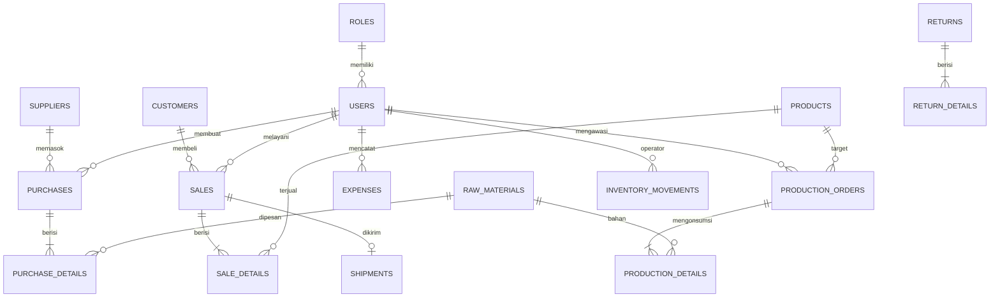

# DOKUMENTASI STRUKTUR BASIS DATA: ERP BATIK MADURA

Sistem basis data dirancang menggunakan **PostgreSQL** dengan integritas data referensial terkelola melalui *Foreign Key Constraints* dan *Cascading Rules*.

---

## 1. Diagram Relasi Entitas (ERD Sederhana)

---

## 2. Rincian Kamus Data Tabel Basis Data

### A. Tabel `roles`
| Kolom | Tipe Data | Keterangan |
| :--- | :--- | :--- |
| `id` | BIGINT PK | Identifier unik peran |
| `name` | VARCHAR(255) UNIQUE | Kode nama sistem (`admin`, `pemilik`, `gudang`, `produksi`, `pembelian`, `penjualan`) |
| `display_name` | VARCHAR(255) | Label antarmuka pengguna |
| `description` | TEXT NULL | Deskripsi tugas peran |
| `timestamps` | TIMESTAMP | Waktu pembuatan & pembaruan |

### B. Tabel `users`
| Kolom | Tipe Data | Keterangan |
| :--- | :--- | :--- |
| `id` | BIGINT PK | Identifier akun pengguna |
| `name` | VARCHAR(255) | Nama staf / pengrajin |
| `email` | VARCHAR(255) UNIQUE | Alamat email login |
| `password` | VARCHAR(255) | Password terenkripsi bcrypt |
| `role_id` | BIGINT FK NULL | Relasi ke `roles.id` |
| `phone` | VARCHAR(255) NULL | Nomor kontak telepon / WhatsApp |
| `is_active` | BOOLEAN | Status akun aktif (true) atau dinonaktifkan (false) |

### C. Tabel `suppliers` (Pilar SOURCE)
| Kolom | Tipe Data | Keterangan |
| :--- | :--- | :--- |
| `id` | BIGINT PK | Identifier pemasok |
| `code` | VARCHAR(255) UNIQUE | Kode unik supplier (contoh: `SUP-001`) |
| `name` | VARCHAR(255) | Nama vendor / perajin mori |
| `contact_person` | VARCHAR(255) NULL | Nama narahubung |
| `phone` | VARCHAR(255) NULL | Nomor telepon vendor |
| `email` | VARCHAR(255) NULL | Email vendor |
| `address` | TEXT NULL | Alamat fasilitas vendor |
| `is_eco_certified` | BOOLEAN | Penanda sertifikasi ramah lingkungan (Green Supplier) |
| `eco_rating` | NUMERIC(3,2) | Skor rating keberlanjutan (1.00 - 5.00) |

### D. Tabel `customers`
| Kolom | Tipe Data | Keterangan |
| :--- | :--- | :--- |
| `id` | BIGINT PK | Identifier pelanggan |
| `code` | VARCHAR(255) UNIQUE | Kode pelanggan (contoh: `CUST-001`) |
| `name` | VARCHAR(255) | Nama pelanggan / butik |
| `phone` | VARCHAR(255) NULL | Nomor WhatsApp pelanggan |
| `email` | VARCHAR(255) NULL | Alamat surel |
| `address` | TEXT NULL | Alamat pengiriman |
| `customer_type` | ENUM | `retail`, `wholesale`, `reseller` |

### E. Tabel `raw_materials` (Pilar SOURCE & MAKE)
| Kolom | Tipe Data | Keterangan |
| :--- | :--- | :--- |
| `id` | BIGINT PK | Identifier bahan mentah |
| `code` | VARCHAR(255) UNIQUE | Kode SKU bahan (contoh: `RAW-001`) |
| `name` | VARCHAR(255) | Nama bahan (Mori Primissima, Malam Klowong, Daun Tom) |
| `category` | ENUM | `kain`, `malam`, `pewarna_alami`, `pewarna_sintetis`, `bahan_pendukung` |
| `unit` | VARCHAR(255) | Satuan ukur (`meter`, `kg`, `liter`, `pcs`) |
| `stock` | NUMERIC(12,2) | Stok fisik aktual di gudang |
| `min_stock` | NUMERIC(12,2) | Batas minimum peringatan order ulang |
| `unit_price` | NUMERIC(14,2) | Harga beli rata-rata satuan |
| `is_eco_friendly` | BOOLEAN | Klasifikasi bahan ramah lingkungan (bebas logam berat) |

### F. Tabel `products`
| Kolom | Tipe Data | Keterangan |
| :--- | :--- | :--- |
| `id` | BIGINT PK | Identifier kain batik jadi |
| `code` | VARCHAR(255) UNIQUE | Kode motif batik (contoh: `BTK-GT-01`) |
| `name` | VARCHAR(255) | Nama kain batik tulis |
| `motif_type` | VARCHAR(255) | Motif khas (Gentongan, Aromanis, Sekar Jagat, Lancor) |
| `size` | VARCHAR(255) | Dimensi kain (standar: 200 x 115 cm) |
| `cost_price` | NUMERIC(14,2) | Harga Pokok Produksi (HPP) |
| `selling_price` | NUMERIC(14,2) | Harga jual kepada pembeli |
| `stock` | INTEGER | Jumlah lembar kain siap jual |
| `min_stock` | INTEGER | Batas minimum stok etalase |
| `is_active` | BOOLEAN | Status jual motif |

### G. Tabel `purchases` & `purchase_details` (SOURCE)
* `purchases`: `purchase_number`, `supplier_id`, `user_id`, `purchase_date`, `total_amount`, `payment_status`, `status`.
* `purchase_details`: `purchase_id`, `raw_material_id`, `quantity`, `unit_price`, `subtotal`, `eco_friendly_verified`.

### H. Tabel `inventories` & `inventory_movements`
* `inventories`: `item_type`, `item_id`, `current_stock`, `safety_stock`, `warehouse_location`.
* `inventory_movements`: `item_type`, `item_id`, `movement_type` (`in`, `out`, `adjustment`, `waste`), `quantity`, `reference_type`, `notes`, `user_id`.

### I. Tabel `production_orders` & `production_details` (MAKE)
* `production_orders`: `order_number`, `target_product_id`, `planned_quantity`, `actual_quantity`, `start_date`, `stage` (`pola_desain`, `canting_malam`, `pewarnaan`, `pelorotan`, `penjemuran`, `finishing`), `status`, **`water_usage_liters`**, **`waste_generated_kg`**, **`recycled_wax_kg`**, `user_id`.
* `production_details`: `production_order_id`, `raw_material_id`, `planned_qty`, `actual_qty`, `unit_cost`, `subtotal_cost`.

### J. Tabel `sales`, `sale_details`, & `shipments` (DELIVER)
* `sales`: `invoice_number`, `customer_id`, `user_id`, `sale_date`, `total_amount`, `discount_amount`, `grand_total`, `payment_method` (`cash`, `transfer_bank`, `qris`), `status`.
* `sale_details`: `sale_id`, `product_id`, `quantity`, `unit_price`, `subtotal`.
* `shipments`: `sale_id`, `tracking_number`, `courier_name`, `shipping_address`, `shipping_date`, `is_on_time`, `status`.

### K. Tabel `returns` & `return_details` (RETURN)
* `returns`: `return_number`, `return_type` (`purchase_return`, `sale_return`), `party_name`, `return_date`, `total_amount`, `reason`, `handling_action` (`replace`, `repair`, `refund`, `dispose`), `status`.
* `return_details`: `return_id`, `item_type`, `item_id`, `quantity`, `condition`.

### L. Tabel `expenses`
* `expenses`: `expense_number`, `category` (`pengolahan_limbah_ipal`, `gaji_pengrajin`, `utilitas_listrik_air`, `operasional`), `amount`, `expense_date`, `description`, `user_id`.

### M. Tabel `green_scor_metrics` & `green_scor_results`
* `green_scor_metrics`: `code`, `dimension` (`PLAN`, `SOURCE`, `MAKE`, `DELIVER`, `RETURN`), `metric_name`, `unit`, `target_value`, `actual_value`, `weight` (bobot ANP dinamis), `normalized_score` (Snorm De Boer), `final_score`.
* `green_scor_results`: `evaluation_period`, `evaluation_date`, `plan_score`, `source_score`, `make_score`, `deliver_score`, `return_score`, `total_index`, `category` (`Poor`, `Marginal`, `Average`, `Good`, `Excellent`), `evaluated_by`.

