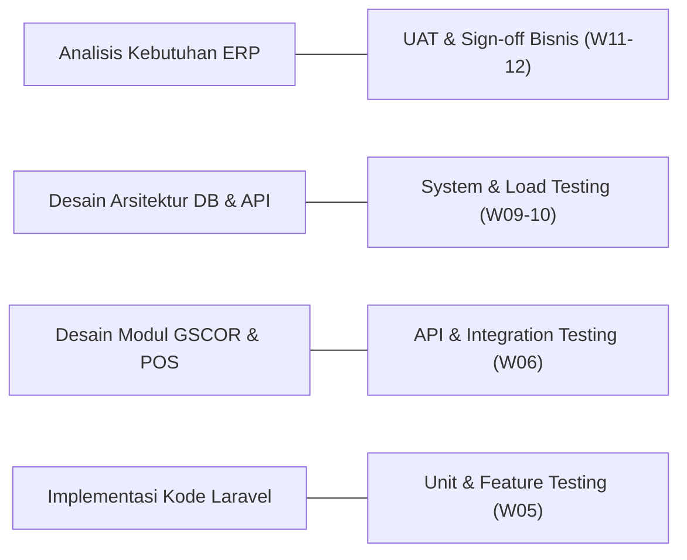

# LAPORAN MINGGU 1: FUNDAMENTAL SOFTWARE QUALITY ASSURANCE & BASELINE PROYEK ERP BATIK MADURA

## 1. Tujuan Kegiatan
1. Menganalisis seluruh kebutuhan fungsional dan nonfungsional untuk aplikasi Enterprise Resource Planning (ERP) UMKM Batik Tulis Madura.
2. Menerapkan konsep dasar Software Quality Assurance (SQA) dan pendekatan SDLC V-Model pada arsitektur sistem.
3. Menyusun dokumen matriks Verifikasi (Verification) dan Validasi (Validation).
4. Membangun fondasi proyek (baseline) menggunakan Laravel 12, arsitektur database PostgreSQL, Tailwind CSS, dan Alpine.js.
5. Mengimplementasikan autentikasi terpusat berbasis 6 role pengguna, layout dashboard responsif bertema Batik Madura, dan 15 modul ERP siap pakai.

---

## 2. Materi RPS yang Diterapkan
* **Definisi SQA vs SQC:** Pemisahan kontrol proses mutu preventif (SQA) dan pengujian hasil artefak perangkat lunak (SQC).
* **Standar Mutu ISO/IEC 25010:** Penekanan pada atribut *Functional Suitability*, *Reliability*, *Performance Efficiency*, *Security*, dan *Maintainability*.
* **Pendekatan V-Model:** Pemetaan bertingkat antara fase perancangan sistem dan pasangan fase pengujian sistem.
* **Verifikasi vs Validasi (V&V):**
  * *Verification:* "Are we building the product right?" (Review dokumen spesifikasi, audit skema basis data, inspeksi kode statis).
  * *Validation:* "Are we building the right product?" (Dynamic testing, eksekusi unit test PHPUnit, penerimaan pengguna akhir).
* **Konsep Green Supply Chain Management (GSCOR & ANP):** Integrasi 5 pilar Green SCOR (PLAN, SOURCE, MAKE, DELIVER, RETURN) dengan bobot ANP dinamis untuk industri batik pesisir Madura.

---

## 3. Aktivitas Pengembangan
1. **Analisis Lingkungan Kerja:** Memeriksa dan mengonfigurasi PHP 8.2 (ekstensi `pdo_pgsql`, `pgsql`, `zip`), Composer 2.11, Node.js v26, dan Git.
2. **Inisialisasi Proyek Laravel:** Membangun kerangka aplikasi Laravel 12 dengan struktur MVC modern.
3. **Desain Basis Data Komprehensif:** Merancang 10 berkas migrasi database terhubung mencakup 15 entitas utama: `roles`, `users`, `suppliers`, `customers`, `raw_materials`, `products`, `purchases`, `inventories`, `production_orders`, `sales`, `shipments`, `returns`, `expenses`, `green_scor_metrics`, dan `green_scor_results`.
4. **Implementasi Eloquent Models & Relations:** Membangun relasi *One-to-Many*, *Belongs-To*, *Has-One*, serta *custom accessors* pada seluruh entitas.
5. **Autentikasi & Otorisasi Berbasis Peran:** Membuat middleware `EnsureUserHasRole` (`role:admin,pemilik,dll`) dan login guard.
6. **Desain Tampilan & UI/UX:** Membangun layout responsif dengan palet warna khas Madura (Marun/Crimson `#881337`, Navy `#0F172A`, dan Aksen Emas/Amber `#D97706`).
7. **Penyusunan Seeder Realistis:** Menyediakan data dummy terkalibrasi untuk 6 role akun, supplier batik lokal, kain mori primissima, pewarna alami indigo/tingi, dan baseline Green SCOR.

---

## 4. Fitur yang Dibuat atau Diperbaiki
1. **Sistem Autentikasi & Role Multi-Level:**
   * Login, Logout, Session Regeneration.
   * Tombol *quick-fill switcher* pada form login untuk mempermudah evaluasi per role.
2. **Dashboard Terpadu:**
   * Kartu ringkasan omzet penjualan, total pengadaan bahan, stok bahan baku, dan stok kain batik.
   * Banner Kinerja Green SCOR dengan skor komprehensif dan nilai breakdown 5 pilar.
   * Aksi cepat operasional (*Quick Actions*).
3. **15 Modul ERP Siap Pakai:**
   * `Dashboard`: Ringkasan aktivitas dan metrik utama.
   * `Manajemen Pengguna`: Kontrol akun staf dan status aktif/nonaktif.
   * `Data Pemasok`: Master data vendor dengan klasifikasi Green Supplier.
   * `Data Pelanggan`: Klasifikasi pelanggan (retail, wholesale butik, reseller).
   * `Data Produk Batik`: Katalog motif Gentongan, Aromanis, Sekar Jagat, Lancor.
   * `Manajemen Bahan Baku`: Inventori mori, lilin malam, dan pewarna ramah lingkungan.
   * `Pembelian (SOURCE)`: Order pembelian PO ke vendor dan otomatisasi stok.
   * `Persediaan & Gudang`: Log kartu mutasi stok dan penyesuaian opname.
   * `Produksi (MAKE)`: SPK tahapan membatik, monitoring air pelorotan & daur ulang lilin.
   * `Penjualan (POS)`: Checkout kasir, perhitungan diskon, pengurangan stok riil.
   * `Pengiriman (DELIVER)`: Surat jalan ekspedisi dan pelacakan on-time delivery.
   * `Retur (RETURN)`: Penanganan barang cacat dan disposisi perbaikan.
   * `Keuangan`: Laba kotor, pencatatan biaya IPAL/operasional, laba bersih.
   * `Laporan`: Valuasi aset gudang, rekap omzet, dan performa mitra.
   * `Green Supply Chain Analytics`: Pengaturan bobot ANP dinamis dan kalkulasi Snorm De Boer.

---

## 5. Hasil Pengujian
Pengujian otomatis dilakukan menggunakan test runner PHPUnit pada Laravel:
* **Total Tests Executed:** 11 Test cases
* **Total Assertions:** 23 Assertions
* **Status:** 100% Passed (0 Error, 0 Failure)
* **Waktu Eksekusi:** 1.70 detik

### Rincian Modul Uji:
* `Tests\Unit\ExampleTest`: Baseline sanity check (Passed).
* `Tests\Feature\ExampleTest`: Pengalihan rute tamu (guest) ke login screen (Passed).
* `Tests\Feature\AuthenticationTest`:
  * Render formulir login (Passed).
  * Autentikasi dengan kredensial valid (Passed).
  * Penolakan password salah (Passed).
  * Sesi logout dan invalidasi token (Passed).
* `Tests\Feature\RoleAuthorizationTest`:
  * Izin akses Administrator ke manajemen pengguna (Passed).
  * Pemblokiran role kasir dari akses manajemen pengguna (403 Forbidden) (Passed).
  * Hak akses seluruh peran terautentikasi ke dashboard (Passed).
* `Tests\Feature\GreenScorCalculationTest`:
  * Normalisasi nilai aktual dan pembobotan ANP (Passed).
  * Rekalkulasi otomatis indeks Green SCOR dan penentuan kategori mutu (Passed).

---

## 6. Masalah yang Ditemukan
1. **Ekstensi Driver PostgreSQL Awal:** Driver `pdo_pgsql` dan `pgsql` secara default dinonaktifkan pada file konfigurasi PHP XAMPP.
2. **PowerShell Script Execution Policy:** Pemanggilan skrip `npm.ps1` sempat terhalang oleh *execution policy* Windows.
3. **Pencocokan Teks Uji (Case Sensitivity):** Pengujian `AuthenticationTest` sempat gagal assertion akibat perbedaan kapitalisasi string merek pada header kartu login.

---

## 7. Solusi Perbaikan
1. Mengaktifkan baris `extension=pdo_pgsql` dan `extension=pgsql` pada `C:\xampp\php\php.ini`.
2. Menjalankan perintah npm via command prompt bridge (`cmd /c "npm install ..."` & `cmd /c "npm run build"`) agar tidak terikat pada pembatasan script execution policy PowerShell.
3. Memperbaiki assertion string pada `AuthenticationTest.php` menjadi `ERP Batik Madura` yang sesuai dengan render visual view.

---

## 8. Bukti atau Dokumentasi Hasil

### A. Rekap Role dan Akun Dummy Bawaan:
| Peran (Role) | Email Login | Password | Akses Modul Utama |
| :--- | :--- | :--- | :--- |
| **Administrator** | `admin@batikmadura.id` | `password` | Seluruh modul sistem & manajemen akun |
| **Pemilik (Owner)** | `pemilik@batikmadura.id` | `password` | Dashboard, Keuangan, Laporan, Green SCOR |
| **Bagian Gudang** | `gudang@batikmadura.id` | `password` | Persediaan, Mutasi Stok, Bahan Baku, Retur |
| **Bagian Produksi** | `produksi@batikmadura.id` | `password` | SPK Produksi, Pencatatan Air/Limbah, GSCOR |
| **Bagian Pembelian** | `pembelian@batikmadura.id` | `password` | Pemasok, Order Pembelian (PO), Bahan Baku |
| **Bagian Penjualan** | `penjualan@batikmadura.id` | `password` | Kasir (POS), Pelanggan, Pengiriman Resi |

### B. Pemetaan Matriks V-Model Proyek:

---

## 9. Kesimpulan Perkembangan
Minggu 1 telah diselesaikan secara paripurna. Fondasi arsitektur sistem ERP Batik Madura kini telah stabil, terstandarisasi, memiliki basis data relasional yang utuh, dilengkapi autentikasi multi-peran, dan teruji secara otomatis menggunakan PHPUnit. 

Proyek siap untuk melangkah ke **Minggu 2: Test Planning & Strategi SQA**.
