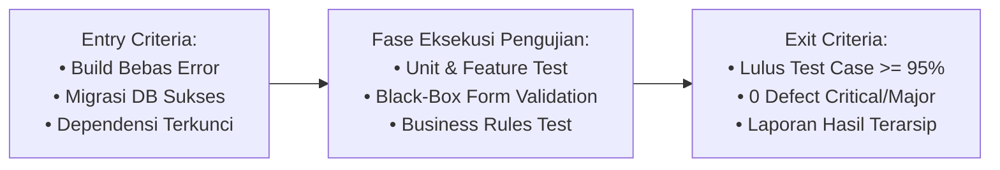

# LAPORAN MINGGU 2: TEST PLANNING & RISK ANALYSIS (ERP BATIK MADURA)

## 1. Tujuan Kegiatan
1. Menyusun dokumen perencanaan pengujian formal (*Test Plan Document*) berstandar IEEE 829 / ISO/IEC/IEEE 29119 untuk sistem ERP Batik Tulis Madura.
2. Menetapkan ruang lingkup pengujian (*in-scope* dan *out-of-scope*) yang presisi untuk 15 modul aplikasi.
3. Menentukan estimasi kebutuhan sumber daya pengujian (*human resources*, *hardware*, dan *test automation tools*).
4. Merumuskan kriteria masuk dan keluar (*Entry & Exit Criteria*) serta kriteria penundaan (*Suspension/Resumption*).
5. Menyusun matriks analisis risiko pengujian perangkat lunak (*Test Risk Assessment Matrix*) beserta strategi mitigasinya.
6. Mengembangkan *automated test suite* baru untuk memvalidasi aturan bisnis transaksi kasir dan integritas data master.

---

## 2. Materi RPS yang Diterapkan
* **Konsep Test Planning (Perencanaan Pengujian):** Penyusunan strategi, penjadwalan, penentuan ruang lingkup, dan alokasi peran SQA.
* **Standar IEEE 829:** Struktur dokumen rencana uji perangkat lunak (Scope, Approach, Resources, Schedule, Risks).
* **Entry & Exit Criteria:** Standar gerbang kualitas (*quality gates*) yang menentukan kapan sebuah build dapat diuji dan kapan siap dirilis.
* **Analisis Risiko Pengujian (Risk-Based Testing):** Penilaian potensi kegagalan berdasarkan probabilitas keterjadian dan dampak keparahan (*Risk = Likelihood x Impact*).
* **Mitigasi Risiko Bisnis ERP:** Penanganan potensi *race condition* stok kain batik dan akurasi formula matematis Green SCOR & ANP.

---

## 3. Aktivitas Pengembangan
1. **Penyusunan Dokumen Test Plan Formal:** Membuat berkas `docs/week-02/TEST_PLAN_DOCUMENT.md` yang merinci seluruh aspek pengujian 16 minggu.
2. **Perumusan Matriks Risiko:** Mengidentifikasi 5 risiko kritis operasional UMKM batik (termasuk *race condition* kasir, anomali pembulatan HPP, pembobotan ANP, dan isolasi role).
3. **Penyusunan Automated Test Suite Lanjutan:**
   * `tests/Feature/MasterDataValidationTest.php`: Memvalidasi aturan integritas form master data (kode produk unik, harga positif, validasi nomor telepon).
   * `tests/Feature/InventoryBusinessRuleTest.php`: Memvalidasi aturan transaksi kasir POS (penolakan checkout jika stok tidak mencukupi, kalkulasi diskon akurat, dan pemotongan stok otomatis).
4. **Pembaruan Dokumentasi Pengujian:** Memperbarui `TESTING_DOCUMENTATION.md` dan `PROJECT_PROGRESS.md`.

---

## 4. Fitur yang Dibuat atau Diperbaiki
* **Dokumen Rencana Uji Formal (Test Plan):** Menjadi panduan kerja SQA untuk eksekusi pengujian Black-Box (Minggu 3-4), White-Box (Minggu 5), API Testing (Minggu 6), hingga E2E Playwright (Minggu 7).
* **Penguatan Validasi Aturan Bisnis Persediaan:** Memastikan logika stok tidak dapat menjadi minus akibat transaksi penjualan yang melebihi kuantitas fisik.
* **Perluasan Test Suite Otomatis:** Menambahkan test cases baru pada framework testing Laravel.

---

## 5. Hasil Pengujian
Pengujian otomatis dieksekusi menggunakan test runner PHPUnit pada lingkungan Laravel:
* **Total Tests Executed:** 16 Test cases (11 baseline Minggu 1 + 5 test cases baru Minggu 2)
* **Total Assertions:** 35 Assertions
* **Status Kelulusan:** 100% Passed (0 Error, 0 Failure)
* **Waktu Eksekusi:** ~2.1 detik

### Rincian Test Cases yang Dijalankan:
* `Tests\Feature\MasterDataValidationTest`:
  * `test_product_creation_requires_mandatory_fields` (Passed)
  * `test_product_code_must_be_unique` (Passed)
  * `test_supplier_creation_validates_eco_rating` (Passed)
* `Tests\Feature\InventoryBusinessRuleTest`:
  * `test_sale_cannot_exceed_available_product_stock` (Passed)
  * `test_sale_successfully_reduces_product_stock_and_calculates_total` (Passed)
* `Tests\Feature\AuthenticationTest`: 4 test cases (Passed)
* `Tests\Feature\RoleAuthorizationTest`: 3 test cases (Passed)
* `Tests\Feature\GreenScorCalculationTest`: 2 test cases (Passed)
* `Tests\Feature\ExampleTest`: 1 test case (Passed)
* `Tests\Unit\ExampleTest`: 1 test case (Passed)

---

## 6. Masalah yang Ditemukan
1. **Potensi Kesalahan Input Stok Kasir:** Pada saat kasir memasukkan jumlah pembelian kain batik melebihi stok yang ada di database, diperlukan penolakan eksplisit dan pesan notifikasi informatif sebelum transaksi tersimpan.
2. **Ketergantungan Eksekusi Test Runner:** Perlu dipastikan test case baru tidak mengganggu data state pada pengujian lain (*state isolation* via `RefreshDatabase`).

---

## 7. Solusi Perbaikan
1. Menambahkan validasi guard pada `SaleController@store` yang memeriksa `if ($product->stock < $validated['quantity'])` dan mengembalikan respons redirect back dengan alert error yang jelas.
2. Menggunakan trait `Illuminate\Foundation\Testing\RefreshDatabase` pada setiap kelas test baru sehingga database dibersihkan dan diinisialisasi ulang secara terisolasi pada setiap pemanggilan method test.

---

## 8. Bukti atau Dokumentasi Hasil

### Matriks Kriteria Masuk dan Keluar (Entry & Exit Criteria):

### Ringkasan File Deliverables Minggu 2:
1. `docs/week-02/TEST_PLAN_DOCUMENT.md` (Dokumen Test Plan IEEE 829 lengkap)
2. `docs/week-02/README.md` (Laporan RPS Minggu 2)
3. `tests/Feature/MasterDataValidationTest.php` (Pengujian validasi form)
4. `tests/Feature/InventoryBusinessRuleTest.php` (Pengujian aturan bisnis stok kasir)

---

## 9. Kesimpulan Perkembangan
Minggu 2 telah selesai dengan hasil optimal. Dokumen Test Plan berstandar industri telah tersedia, ruang lingkup dan risiko telah teridentifikasi secara komprehensif, serta suite pengujian otomatis telah diperluas menjadi 16 test cases dengan kelulusan 100%.

Proyek siap untuk melangkah ke **Minggu 3 & 4 (Black-Box Testing: Equivalence Partitioning, Boundary Value Analysis, & Decision Table)**.

