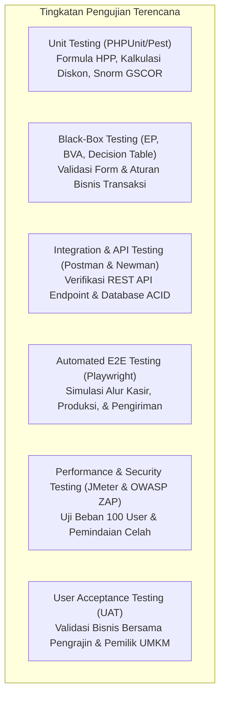

# DOKUMEN TEST PLAN: ERP BATIK TULIS MADURA
**Standar Format Acuan: IEEE 829 / ISO/IEC/IEEE 29119**  
**Identifikasi Dokumen:** TP-BM-W02-2026-V1.0  
**Tanggal Terbit:** 9 November 2026  
**Penulis:** SQA & System Analyst Team  
**Status:** Disetujui (Approved Baseline)

---

## 1. PENDAHULUAN (INTRODUCTION)

### 1.1 Latar Belakang
Aplikasi **ERP Batik Madura** merupakan sistem informasi berbasis web yang mengintegrasikan seluruh operasional rantai pasok UMKM Batik Tulis Madura (mulai dari pengadaan bahan baku, produksi canting, penjualan kasir, pengiriman, retur cacat, hingga pelaporan keuangan) dengan pemantauan terintegrasi berbasis **Green Supply Chain Management (GSCOR & ANP)**.

Dokumen Test Plan ini disusun untuk memetakan strategi pengujian, ruang lingkup, estimasi sumber daya, alokasi jadwal pengujian 16 minggu, kriteria masuk/keluar (*Entry & Exit Criteria*), serta mitigasi risiko kegagalan perangkat lunak guna memastikan keandalan, akurasi perhitungan HPP/laba, dan keabsahan metrik ramah lingkungan.

### 1.2 Tujuan Pengujian (Test Objectives)
1. **Memastikan Kesesuaian Fungsional (*Functional Suitability*):** Menjamin seluruh 15 modul berjalan sesuai spesifikasi bisnis tanpa cacat kritis (*Critical/Blocker Defect*).
2. **Menjamin Integritas Transaksi (*Data Integrity & ACID*):** Menjamin konsistensi stok persediaan (kain mori, malam, pewarna, dan batik siap jual) tidak mengalami *race condition* atau data anomali saat transaksi simultan.
3. **Memvalidasi Formula Green SCOR & ANP:** Memverifikasi kalkulasi normalisasi *Snorm De Boer* dan pembobotan dinamis ANP menghasilkan indeks kinerja yang presisi secara matematis.
4. **Menjamin Keamanan Hak Akses (*Role-Based Access Control*):** Memastikan pembatasan hak akses 6 role pengguna (Admin, Pemilik, Gudang, Produksi, Pembelian, Penjualan) terisolasi secara ketat.

---

## 2. RUANG LINGKUP PENGUJIAN (TEST SCOPE)

### 2.1 Fitur yang Diuji (Features to be Tested - In-Scope)
* **Modul 01 - Dashboard:** Akurasi agregasi kartu statistik (omzet, pengadaan, stok, alert stok menipis, widget GSCOR).
* **Modul 02 - Manajemen Pengguna:** Alur autentikasi login/logout, hashing password bcrypt, regenerasi sesi, dan isolasi hak akses role.
* **Modul 03 - Data Pemasok:** Validasi input, verifikasi sertifikasi Green Supplier, dan audit rating vendor.
* **Modul 04 - Data Pelanggan:** Pengelolaan kontak pelanggan retail, wholesale butik, dan reseller.
* **Modul 05 - Data Produk Batik:** Pengelolaan katalog motif (Gentongan, Aromanis, Sekar Jagat, Lancor), HPP vs Harga Jual, dan batas minimum stok.
* **Modul 06 - Bahan Baku:** Kontrol stok mori primissima, malam tawon, pewarna alami, serta atribut bahan ramah lingkungan.
* **Modul 07 - Pembelian (SOURCE):** Penerbitan PO bahan baku, validasi harga, dan penambahan otomatis stok gudang.
* **Modul 08 - Persediaan & Gudang:** Validasi kartu mutasi stok (in, out, adjustment, waste) dan integritas stok opname.
* **Modul 09 - Produksi (MAKE):** Penerbitan SPK tahapan membatik, pencatatan konsumsi air pelorotan (L), dan daur ulang lilin malam (kg).
* **Modul 10 - Penjualan Kasir (POS):** Alur checkout kasir, validasi kecukupan stok, perhitungan diskon, metode pembayaran, dan nomor invoice.
* **Modul 11 - Pengiriman (DELIVER):** Pembuatan surat jalan, penomoran resi ekspedisi, dan perhitungan metrik *On-Time Delivery*.
* **Modul 12 - Retur (RETURN):** Berita acara klaim cacat kain dan tindakan penanganan (*replace*, *repair*, *refund*, *dispose*).
* **Modul 13 - Keuangan:** Laba kotor, pencatatan beban operasional IPAL/pengrajin, dan kalkulasi estimasi laba bersih.
* **Modul 14 - Laporan:** Valuasi aset stok barang dagang, omzet kasir, dan ringkasan pengadaan.
* **Modul 15 - Green Supply Chain Analytics:** Pengujian pembobotan dinamis ANP, normalisasi nilai aktual vs target, dan rekalkulasi indeks berkala.

### 2.2 Fitur yang Tidak Diuji pada Tahap Ini (Features Not to be Tested - Out-of-Scope)
* Integrasi Payment Gateway pihak ketiga (Midtrans/Xendit) secara live production (fokus saat ini menggunakan simulasi transaksi tunai, transfer bank, dan QRIS lokal).
* Integrasi API kurir logistik pihak ketiga secara real-time (RajaOngkir/J&T API) (saat ini menggunakan simulasi surat jalan dan input nomor resi internal).
* Kompatibilitas browser versi usang (Internet Explorer 11).

---

## 3. PENDEKATAN & METODOLOGI PENGUJIAN (TEST APPROACH)

Pengujian mengadopsi prinsip **V-Model SDLC** yang berkesinambungan dari Minggu ke-1 hingga Minggu ke-16:

---

## 4. KRITERIA MASUK & KELUAR (ENTRY & EXIT CRITERIA)

### 4.1 Kriteria Masuk Pengujian (Entry Criteria)
Sebuah modul atau fitur dinyatakan layak masuk ke tahap pengujian formal apabila:
1. Kode sumber telah selesai diimplementasikan, bebas dari *syntax error*, dan berhasil dikompilasi via Vite (`npm run build`).
2. Skema migrasi database berhasil dieksekusi tanpa galat (`php artisan migrate:fresh --seed`).
3. Seluruh dependensi pihak ketiga (Composer & NPM) terkunci secara deterministik (`composer.lock` & `package-lock.json`).
4. Unit test baseline (pengujian dasar) lulus 100%.

### 4.2 Kriteria Keluar Pengujian (Exit Criteria)
Pengujian dinyatakan selesai dan perangkat lunak siap dirilis/masuk fase berikutnya apabila:
1. **Tingkat Kelulusan Test Case:** Minimal 95% dari seluruh test case yang dirancang berstatus **PASSED**.
2. **Defect Severity:**
   * **Critical / Blocker (P1):** 0 defect terbuka (Harus terselesaikan 100%).
   * **Major / High (P2):** 0 defect terbuka.
   * **Minor / Low (P3):** Maksimal 2 defect minor yang tidak mengganggu operasional utama (tercatat di `BUG_REPORT.md`).
3. **Dokumentasi Hasil Uji:** Laporan hasil pengujian terarsip pada folder `docs/week-XX/`.
4. **Code Coverage:** Minimal 80% cakupan baris kode pada modul transaksi dan formula HPP/GSCOR.

### 4.3 Kriteria Penundaan & Dimulainya Kembali (Suspension & Resumption Criteria)
* **Suspension:** Jika ditemukan bug kritis yang memblokir pengujian seluruh modul (misalnya: database gagal koneksi atau crash sistem saat login).
* **Resumption:** Pengujian dilanjutkan kembali setelah bug blocker diperbaiki dan dilakukan build ulang.

---

## 5. ESTIMASI KEBUTUHAN SUMBER DAYA (RESOURCE ESTIMATION)

### 5.1 Sumber Daya Manusia (Human Resources)
| Peran (Role) | Tanggung Jawab Utama | Alokasi Waktu |
| :--- | :--- | :--- |
| **SQA Lead / System Analyst** | Merancang Test Plan, memimpin audit mutu, review dokumen IEEE 829 | 4 jam / minggu |
| **Test Automation Engineer** | Mengembangkan skrip otomatis (PHPUnit, Newman CLI, Playwright) | 8 jam / minggu |
| **Functional Tester (Manual)** | Menjalankan skenario EP, BVA, Decision Table, dan verifikasi UI/UX | 6 jam / minggu |
| **DevOps & Performance Tester** | Menyiapkan pipeline CI/CD, mengonfigurasi JMeter & OWASP ZAP | 4 jam / minggu |

### 5.2 Lingkungan Perangkat Keras & Lunak (Hardware & Software Environment)
| Komponen | Spesifikasi / Alat | Fungsi |
| :--- | :--- | :--- |
| **Server Uji (Local/Staging)** | Windows 11 / Linux Ubuntu 22.04 LTS (RAM 8 GB+, 4 vCPU) | Menjalankan aplikasi Laravel & PostgreSQL |
| **Bahasa & Framework** | PHP 8.2+ CLI & Laravel 12 Framework | Backend runtime |
| **Database Server** | PostgreSQL 16 (dengan opsi container Docker) | Engine penyimpanan relasional |
| **Automated Test Runners** | PHPUnit 11.5, Newman CLI v6, Playwright Test | Test runner otomatis |
| **Performance Test Tool** | Apache JMeter 5.6 (Simulasi 100 concurrent threads) | Pengujian beban transaksi kasir |
| **Security Scanner** | OWASP ZAP (Zed Attack Proxy) v2.14 | Pemindaian kerentanan form input |
| **Defect Tracking** | GitHub Issues & `BUG_REPORT.md` | Pencatatan cacat perangkat lunak |

---

## 6. JADWAL PENGUJIAN 16 MINGGU (TEST SCHEDULE MILESTONES)

```mermaid
flowchart LR
    W1_2["W01-W02:<br>Fundamental SQA & Test Plan"] --> W3_4["W03-W04:<br>Black-Box EP, BVA & Decision Table"]
    W3_4 --> W5_6["W05-W06:<br>White-Box CFG & API Postman/Newman"]
    W5_6 --> W7_8["W07-W08:<br>Playwright E2E & Audit UTS"]
    W7_8 --> W9_10["W09-W10:<br>Load JMeter & Security OWASP"]
    W9_10 --> W11_12["W11-W12:<br>UAT & Strategi Cutover"]
    W11_12 --> W13_14["W13-W14:<br>ETL Migration & CI/CD Actions"]
    W13_14 --> W15_16["W15-W16:<br>PIR & Demo UAS Rollback"]
```

---

## 7. MATRIKS ANALISIS RISIKO PENGUJIAN (TEST RISK ASSESSMENT MATRIX)

| ID Risiko | Deskripsi Potensi Risiko | Probabilitas | Dampak | Tingkat Risiko | Strategi Mitigasi / Penanganan |
| :---: | :--- | :---: | :---: | :---: | :--- |
| **RSK-01** | **Race Condition pada Checkout Kasir:** Dua kasir menjual kain batik sisa 1 lembar secara bersamaan sehingga stok menjadi minus. | Sedang (3) | Kritis (5) | **TINGGI (15)** | Menerapkan `DB::transaction` dengan `lockForUpdate()` pada model Product saat validasi stok. |
| **RSK-02** | **Kalkulasi Desimal Tidak Akurat:** Kesalahan pembulatan nominal HPP atau skor Green SCOR akibat perbedaan tipe data float. | Rendah (2) | Tinggi (4) | **SEDANG (8)** | Menggunakan tipe data `decimal(14,2)` di PostgreSQL dan fungsi pembulatan presisi `round($val, 2)` pada Service Layer. |
| **RSK-03** | **Bypass Otorisasi Role Pengguna:** Staf gudang atau kasir mencoba mengakses URL `/users` atau `/finance`. | Rendah (2) | Kritis (5) | **SEDANG (10)** | Menerapkan middleware terpusat `EnsureUserHasRole` yang mengembalikan `403 Forbidden` jika role tidak sesuai. |
| **RSK-04** | **Ketidaksediaan Server PostgreSQL Lokal pada Mesin Penguji:** Penguji tidak memiliki PostgreSQL daemon aktif di background. | Sedang (3) | Sedang (3) | **SEDANG (9)** | Menyediakan container `docker-compose.yml` terisolasi dan konfigurasi otomatis fallback SQLite in-memory untuk testing suite. |
| **RSK-05** | **Perubahan Bobot ANP Menghasilkan Nilai $> 1.0000$:** Pengguna memasukkan total bobot yang melebihi standar 100%. | Sedang (3) | Tinggi (4) | **SEDANG (12)** | Memberikan validasi form `numeric|between:0,1` dan alert peringatan jumlah akumulasi bobot di UI. |

---

## 8. DELIVERABLES PENGUJIAN (TEST DELIVERABLES)
1. Dokumen Test Plan resmi (`docs/week-02/TEST_PLAN_DOCUMENT.md`).
2. Test Case Specification Suites (`tests/Feature/` dan `tests/Unit/`).
3. Laporan Hasil Eksekusi Pengujian Mingguan (`docs/week-XX/README.md`).
4. Log Pencatatan Defect (`BUG_REPORT.md` & GitHub Issues).
5. Berita Acara UAT & UAT Sign-off Form (Fase Minggu 11).

