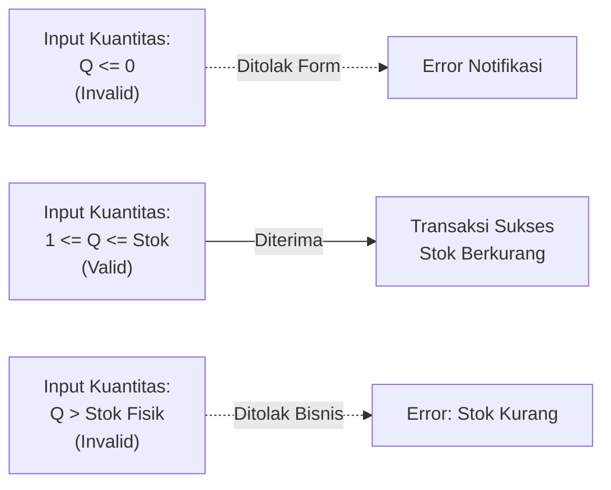

# LAPORAN MINGGU 3: BLACK-BOX TESTING (EQUIVALENCE PARTITIONING & BOUNDARY VALUE ANALYSIS)

## 1. Tujuan Kegiatan
1. Menerapkan teknik pengujian fungsional *Black-Box Testing* menggunakan metode **Equivalence Partitioning (EP)** dan **Boundary Value Analysis (BVA)** sesuai silabus Sub-CPMK 3 RPS MANPRO 2026.
2. Menentukan partisi valid dan invalid serta nilai-nilai batas ekstrem pada form master data produk batik, bahan baku, persediaan gudang, dan kasir penjualan POS.
3. Mengidentifikasi celah aturan bisnis dan cacat input (*input validation defects*) pada level controller dan database.
4. Memperbaiki dan memperkuat logika validasi backend pada transaksi kasir dan mutasi persediaan barang.
5. Mengembangkan *automated test suite* PHPUnit khusus untuk menguji nilai-nilai batas secara otomatis.

---

## 2. Materi RPS yang Diterapkan
* **Equivalence Partitioning (EP):** Pembagian domain input ke dalam kelas-kelas ekuivalen data valid dan invalid untuk meminimalkan redundansi kasus uji.
* **Boundary Value Analysis (BVA):** Pengujian pada tepi dan batas ekstrem partisi: Nilai Minimum ($\text{Min}$), Tepat di Bawah Minimum ($\text{Min}-1$), Nilai Nominal, Tepat di Atas Maksimum ($\text{Max}+1$), dan Nilai Maksimum ($\text{Max}$).
* **Aturan Bisnis Komoditas Batik Madura:**
  * Kuantitas checkout kain batik tidak boleh melebihi stok fisik etalase.
  * Diskon kasir tidak boleh melampaui nilai subtotal transaksi belanja.
  * Mutasi keluar atau limbah kain di gudang tidak boleh menghasilkan saldo persediaan negatif.

---

## 3. Aktivitas Pengembangan
1. **Perancangan Matriks Test Case:** Menyusun matriks pengujian lengkap pada berkas `docs/week-03/TEST_CASE_BLACKBOX_EP_BVA.md`.
2. **Audit Kode Sumber & Pengujian Form:**
   * Memeriksa `SaleController@store`: Menemukan bahwa diskon yang melebihi subtotal sebelumnya tidak memicu validasi error.
   * Memeriksa `InventoryController@adjust`: Menemukan bahwa mutasi keluar tipe `out` dan `waste` tidak memvalidasi kuantitas terhadap sisa stok fisik.
3. **Perbaikan & Penguatan Logika Backend:**
   * Menambahkan validasi guard pada `SaleController.php` untuk menolak transaksi jika `discount_amount > subtotal`.
   * Menambahkan validasi guard pada `InventoryController.php` untuk menolak mutasi keluar jika `quantity > current_stock`.
4. **Implementasi Skrip Uji Otomatis:** Membangun berkas pengujian `tests/Feature/BlackBoxEpBvaTest.php` yang memuat 4 method pengujian BVA & EP komprehensif.

---

## 4. Fitur yang Dibuat atau Diperbaiki
* **Perbaikan Cacat Bisnis Kasir (SaleController):** Validasi ketat yang menolak diskon kasir jika melebihi nilai subtotal belanja.
* **Perbaikan Cacat Mutasi Gudang (InventoryController):** Validasi batas stok fisik saat penyesuaian opname keluar atau limbah rusak agar saldo gudang tidak bernilai minus.
* **Penambahan Suite Otomatis BVA & EP:** Suite pengujian baru dengan 4 test cases dan 27 assertions baru.

---

## 5. Hasil Pengujian
Pengujian otomatis dieksekusi menggunakan test runner PHPUnit pada framework Laravel:
* **Total Tests Executed:** 20 Test cases (16 baseline sebelumnya + 4 test cases BVA & EP)
* **Total Assertions:** 68 Assertions
* **Tingkat Kelulusan:** 100% Passed (0 Error, 0 Failure)
* **Waktu Eksekusi:** ~20 detik

### Rincian Eksekusi Test Suite:
* `Tests\Feature\BlackBoxEpBvaTest`:
  * `test_bva_cashier_quantity_boundaries`: Menguji batas $Q=0, Q=1, Q=\text{stock}, Q=\text{stock}+1$ (**PASSED**).
  * `test_bva_cashier_discount_boundaries`: Menguji batas diskon negatif, diskon 0, diskon 100%, dan diskon $> \text{subtotal}$ (**PASSED**).
  * `test_bva_inventory_adjustment_boundaries`: Menguji batas kuantitas opname keluar terhadap stok fisik (**PASSED**).
  * `test_bva_master_data_boundaries`: Menguji batas harga jual dan stok negatif pada form produk (**PASSED**).
* Seluruh 16 test cases dari Minggu 1 dan Minggu 2 tetap berjalan lulus 100% (*No Regression*).

---

## 6. Masalah yang Ditemukan (Defects Identified)
Melalui penerapan teknik BVA dan EP pada Minggu 3, ditemukan 2 cacat nyata (*real defects*) pada kode aplikasi:
1. **Cacat 1 (Kasir POS):** Kasir dapat menginputkan nominal diskon yang lebih besar dari total harga transaksi, di mana sistem sebelumnya hanya membatasi `$grandTotal = max(0, $subtotal - $discount)` tanpa menampilkan pesan kesalahan validasi kepada kasir.
2. **Cacat 2 (Gudang):** Operator gudang dapat mencatat mutasi barang keluar (`out`) atau barang limbah (`waste`) melebihi stok yang tersisa, yang mengakibatkan nilai stok fisik di database menjadi bilangan negatif.

---

## 7. Solusi Perbaikan (Remediation)
1. **Solusi Cacat 1:** Menambahkan pengondisian `if ($discount > $subtotal)` pada `SaleController.php` yang mengembalikan pesan error informatif: *"Nilai diskon tidak boleh melebihi total belanja."*
2. **Solusi Cacat 2:** Menambahkan pemeriksaan `if ($item->stock < $validated['quantity'])` pada `InventoryController.php` sebelum memotong stok, sehingga transaksi mutasi dibatalkan jika stok tidak mencukupi.

---

## 8. Bukti atau Dokumentasi Hasil

### Matriks Partisi Nilai Batas Kasir:

### Rekap File Minggu 3:
1. `docs/week-03/TEST_CASE_BLACKBOX_EP_BVA.md` (Matriks rancangan kasus uji EP & BVA)
2. `docs/week-03/README.md` (Laporan resmi RPS Minggu 3)
3. `tests/Feature/BlackBoxEpBvaTest.php` (Skrip automated tests)
4. `BUG_REPORT.md` (Pencatatan defect BUG-004 dan BUG-005)

---

## 9. Kesimpulan Perkembangan
Pekan 3 telah diselesaikan dengan sukses. Penerapan teknik *Equivalence Partitioning* dan *Boundary Value Analysis* berhasil membuktikan efektivitas pengujian Black-Box dalam mendeteksi 2 celah aturan bisnis yang krusial pada modul kasir dan mutasi gudang. Celah tersebut kini telah diperbaiki, divalidasi dengan automated tests, dan seluruh 20 pengujian lulus 100%.

Proyek siap untuk melangkah ke **Minggu 4: Advanced Black-Box Testing (Decision Table & State Transition Testing)**.
